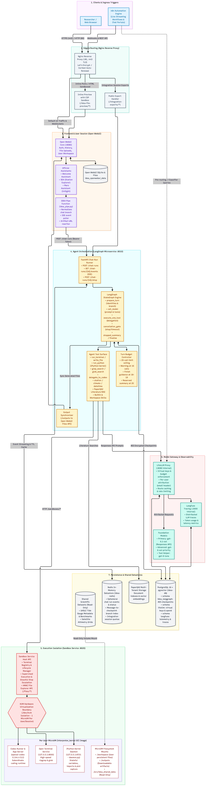
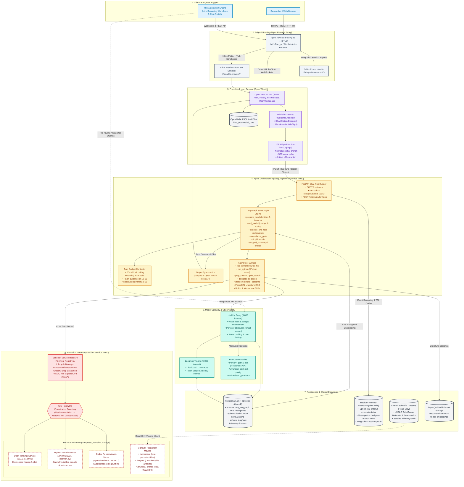
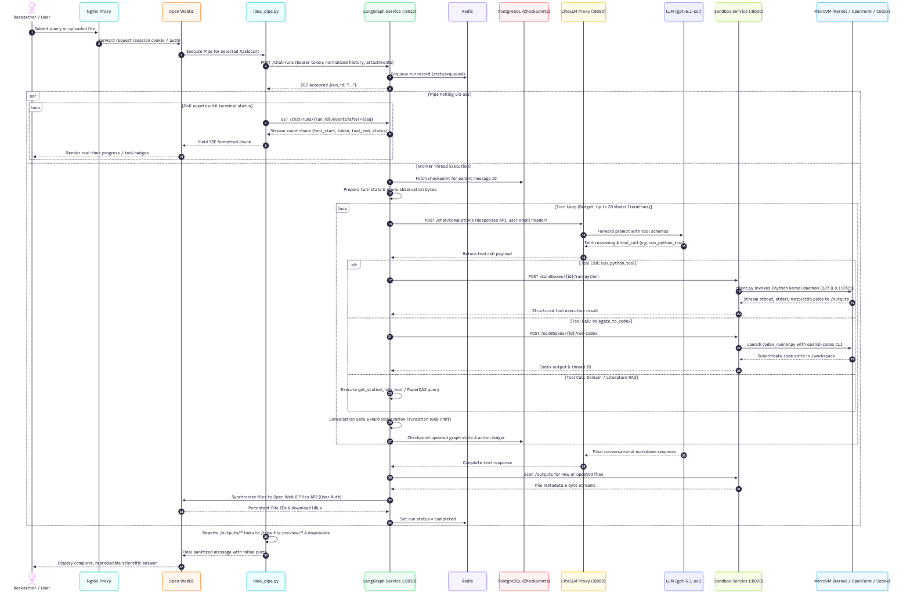
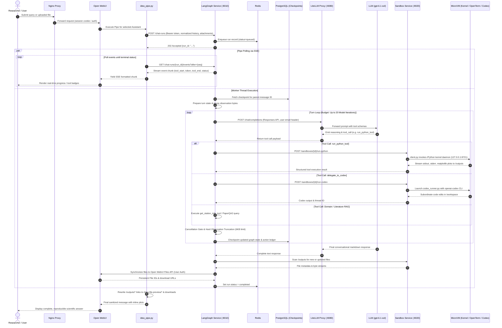

# IDEA System Architecture

This document provides a comprehensive technical overview of the **Intelligent Data Exploring Assistant (IDEA)** architecture as implemented on the `next-dev` branch.

IDEA is an action-oriented, tool-using AI platform tailored for scientific data analysis, oceanographic research, tide-gauge exploration, and planetary science. Unlike conventional chat assistants, IDEA executes code in dedicated, hardware-isolated microVMs, generates traceable and reproducible artifacts (plots, datasets, HTML reports), searches scientific literature with retrieval-augmented generation (RAG), and coordinates specialized scientific workflows.

---

## 1. High-Level Architecture

The IDEA architecture separates user interaction, conversation orchestration, secure isolated code execution, model proxying, and persistent storage into loosely coupled microservices deployed via Docker Compose.

### 1.1 Architecture Diagram

*(High-resolution vector format available at [`assets/idea-architecture.svg`](assets/idea-architecture.svg))*

Click to view Mermaid.js source

---

## 2. Core Subsystems

### 2.1 Ingress & Edge Layer (`nginx`)
The edge proxy is managed by `idea-nginx` (defined in `nginx/`):
- **TLS Termination & Certbot Integration:** Listens on port 80 and 443 with Let's Encrypt automated certificate renewals (`deployment/renew-production-cert.sh`).
- **Main Traffic Proxy:** Proxies `/` and WebSocket connections directly to Open WebUI (`http://openwebui:8080`) with streaming buffers disabled to support low-latency Server-Sent Events (SSE).
- **Inline Content Security Policy (CSP) Sandbox (`/idea-file-preview/*`):** Transparently rewrites incoming preview requests to Open WebUI's file content API (`/api/v1/files/$1/content`) while forcing `Content-Disposition: inline` and a strict `Content-Security-Policy: sandbox allow-scripts allow-downloads allow-modals allow-popups`. This allows generated HTML files and interactive JavaScript charts (e.g., Folium, Plotly) to execute in an isolated origin without risking session cookie theft.
- **Integration Exports (`/integration-exports/*`):** Public, authenticated-by-unguessable-UUID endpoint routed to LangGraph for external programmatic downloads.
- **Legacy & Sharing Routes:** Routes `/share/` and `/idea-api/` to the legacy FastAPI backend for shared conversation playback.

### 2.2 UI & Conversation Management Layer (`openwebui`)
User authentication, chat UI, conversation branching, file uploads, and knowledge collections are provided by a customized deployment of Open WebUI (pinned image `idea-openwebui:0.12.5-idea.0.11`):
- **Custom Pipe Function (`openwebui/functions/idea_pipe.py`):** Acts as the bridge between Open WebUI and the LangGraph microservice:
  - Normalizes the conversation branch, stripping system tokens and compacting prior turn messages.
  - Submits a background run via `POST /chat-runs` with `INTERNAL_SERVICE_TOKEN` bearer authentication.
  - Polls ordered sequence-numbered events from `GET /chat-runs/{run_id}/events?after={seq}`.
  - Translates sandbox-internal artifact references (`sandbox:/outputs/plot.png` or `file:/outputs/report.html`) into durable Open WebUI file URLs and authenticated `/idea-file-preview/` endpoints.
  - Intercepts user stop actions to trigger graceful cancellation.
- **Official Assistants (`assistants/manifest.json`):**
  - **Welcome Assistant (`welcome-assistant`):** Guided introduction to IDEA capabilities, prompt suggestions, and reproducible science workflows.
  - **SEA (`sea` - Station Explorer Assistant):** Specialized assistant for the University of Hawaii Sea Level Center (UHSLC). Formulated for tide gauge records (Fast Delivery, Research Quality, RAPID), tidal datums (MSL, MHHW, HAT), station benchmarks, and coastal flooding risk analysis.
  - **Mars Assistant (`mars-assistant`):** Planetary science assistant equipped for NASA InSight lander atmospheric pressure/temperature datasets, sol-to-UTC conversions, and Martian surface imagery.

### 2.3 Agent Orchestration Engine (`langgraph`)
The LangGraph service (`idea_langgraph`, internal port `8010`) is the brain of IDEA. It executes the conversational agent graph, manages tools, bounds context size, and persists checkpoints:
- **StateGraph Architecture (`langgraph/idea_graph/graph.py`):**
  - `prepare_turn`: Resolves execution identities (user ID, session ID, workspace ID), restores checkpoint state, and applies budget guidance.
  - `call_model`: Calls the configured LLM via LiteLLM using the Responses API with system prompts, domain instructions, and tool definitions.
  - `execute_one_tool`: Dispatches exactly one tool per step to prevent unbounded concurrent operations.
  - `cancellation_gate`: Checks for cooperative stop signals or execution timeouts between tool invocations.
  - `stopped_summary` / `finalize`: Syncs `/outputs` to Open WebUI and prepares the final message payload.
- **Turn Execution Budget Guardrails (`langgraph/iteration_budget.py`):**
  - Imposes a strict ceiling of 20 model calls per turn.
  - At call 16: System injects remaining-budget warnings.
  - At calls 18–19: Emphasizes wrapping up essential work, finalizing code, and writing output files.
  - At call 20: Tool execution is disabled; the agent is required to provide a concise progress summary and check in with the user.
  - The user can simply reply `"continue"` to resume with a fresh 20-call budget while preserving all checkpointed state and variables.
- **Observation Hard-Bounding & Memory Safety:**
  - Enforces `IDEA_MAX_MODEL_TOOL_OBSERVATION_BYTES` (default 6,000 bytes) on every tool result to protect against context-window exhaustion.
  - Full tool outputs are archived inside the sandbox; the agent receives an excerpt and can query specific byte ranges via `read_output_range_tool`.
- **Durable Checkpoints:** Checkpoints are stored in PostgreSQL (`idea_langgraph` schema) with optional AES encryption (`LANGGRAPH_AES_KEY`). Checkpoints preserve action ledgers, Python variable names, artifact references, and Codex thread IDs.
- **Ephemeral State in Redis:** Tracks active run statuses (`queued`, `running`, `completed`, `stopped`, `failed`), event streams with sequence IDs, and Open WebUI message-to-checkpoint mappings.

### 2.4 Agent Tool Surface
The agent has access to a rich set of capabilities registered in `langgraph/agents/terminal_agent.py`:
- **Shell & Files:** `run_terminal_tool`, `write_file_tool`, `read_output_range_tool`, `restart_terminal_tool`.
- **Stateful Python Execution:** `run_python_tool` executes code inside the persistent IPython kernel.
- **Code Search:** `grep_search_tool` and `glob_search_tool` powered by Open Terminal (ripgrep/glob).
- **Subordinate Coding Agent (`delegate_to_codex`):** Delegates extensive refactoring or coding tasks to an embedded OpenAI Codex CLI runner inside the user's microVM. Codex operates under strict `deny_all` approval, restricted to `/workspace`, with read-only or workspace-write permissions.
- **Vision Tools:** `show_image_tool` (presents figures to users) and `inspect_image_tool` (allows the model to inspect images multi-modally).
- **Domain Tools:**
  - `get_station_info_tool`: Queries UHSLC tide gauge catalogs and ERDDAP.
  - `get_climate_indices_tool`: Fetches NOAA climate time series (ONI, SOI, PDO, etc.).
  - `get_datetime_tool`: Provides current UTC and local timestamps.
  - `web_search_tool`: Internet queries powered by `IDEA_TOOL_MODEL`.
- **Literature RAG (`query_knowledge_base_tool`):** Multi-tenant scientific paper QA using [PaperQA2](https://github.com/Future-House/paper-qa), indexing uploaded PDF, DOCX, and text documents into localized vector stores.
- **Domain Skills:** Extensible skill modules loaded from `langgraph/utils/skills/` (e.g. `cora-aws`, `gesla-uhslc`, `sea-level-forecast-explorer`, `uhslc-incoming-tide-gauges`, `frontend-design`, `latex`, `poster-design`).

### 2.5 Execution Isolation & Sandbox Layer (`sandbox_service`)
User code execution never runs in the LangGraph container. All commands, Python scripts, file operations, and Codex sessions run inside hardware-isolated microVMs:
- **Sandbox Service Daemon (`sandbox_service/main.py`, port `8020`):**
  - Manages microVM lifecycles via the `microsandbox` Python SDK.
  - Binds directly to `/dev/kvm` for kernel-level hardware virtualization.
  - Maintains `TerminalRegistry` mapping sessions to dedicated microVMs.
  - Imposes resource limits per microVM (e.g., 1 CPU, 1024 MB RAM, 4096 MB disk).
  - Exposes an HMAC-authenticated File Explorer API (`/files/*`) allowing Open WebUI users to browse their sandbox workspace.
- **MicroVM Guest Image (`interpreter_kernel`):**
  - Base Image: Unmodified `open-webui/open-terminal` providing ripgrep and glob services on `127.0.0.1:8000`.
  - Python Kernel Daemon (`daemon.py` on `127.0.0.1:8721`): An IPython kernel daemon derived from Open Interpreter's execution engine. Retains in-memory variables, imports, and dataframes across conversation turns. Automatically intercepts `matplotlib.pyplot.show()` to export figures to `/outputs`.
  - Codex App-Server (`codex_runner.py`): Pinned `openai-codex==0.144.4` runtime executing delegated coding turns within `/workspace`.
  - Guest Mounts:
    - `/workspace`: Persistent user files.
    - `/outputs`: Synced to Open WebUI as downloadable artifacts.
    - `/srv/idea_shared_data`: Read-only reference datasets (tide-gauge metadata, benchmarks, altimetry).

### 2.6 Model Gateway & Observability Layer (`litellm` & `langfuse`)
- **LiteLLM Proxy (`idea_litellm`, port `8030` internally):**
  - Acts as the central AI gateway for all LLM calls.
  - Enforces per-user budget tracking and attribution via `LITELLM_END_USER_HEADER` (forwarding user emails).
  - Handles routing, rate limiting, and virtual key authorization.
  - Configured with `gpt-6.1-sol` (primary model with medium reasoning effort using the Responses API), `gpt-6-sol-priority` (advanced model), and `gpt-6-luna` (lightweight helper model for search and classification).
- **Langfuse Tracing (`idea_langfuse`, port `3050` internally):**
  - Captures distributed traces for every LLM completion.
  - Records prompt tokens, completion tokens, latency, cost attribution, and reasoning step traces.

### 2.7 Storage & Persistence Layer
- **PostgreSQL 16 with `pgvector` (`idea-db`):**
  - Dedicated partitioned roles and schemas:
    - `idea_langgraph`: Checkpoints, thread memory, action ledgers.
    - `litellm`: Virtual keys, user spend, budgets, model routes.
    - `langfuse`: Traces, spans, metrics, evaluations.
- **Redis (`idea-redis`):**
  - Manages ephemeral `/chat-runs` status and sequence event queues (24-hour default TTL).
  - Caches Open WebUI message-to-checkpoint mappings.
  - Powers LiteLLM caching and rate limiting.
- **Named Volumes:**
  - `app-db-data`: PostgreSQL cluster data.
  - `idea_redis_data`: Redis append-only persistence.
  - `idea_openwebui_data`: Open WebUI database, file uploads, and knowledge vectors.
  - `idea_microsandbox_data`: MicroVM base images and overlay disks.
  - `idea_shared_data`: Pre-seeded scientific reference datasets.
  - `idea_paperqa_data`: PaperQA2 multi-tenant document indexes.

---

## 3. End-to-End Request & Turn Execution Lifecycle

The diagram below details the step-by-step lifecycle of a researcher's chat message through the IDEA architecture:

*(High-resolution vector format available at [`assets/idea-turn-sequence.svg`](assets/idea-turn-sequence.svg))*

Click to view Mermaid.js source

---

## 4. Security, Isolation & Multi-Tenancy Boundaries

| Boundary | Mechanism | Description |
| :--- | :--- | :--- |
| **Edge Ingress** | Nginx Reverse Proxy | TLS termination, strict header forwarding, and isolation of preview routes. |
| **Web Preview Sandbox** | Content-Security-Policy (CSP) | HTML and interactive JS visualizations execute in an opaque sandbox origin (`sandbox allow-scripts allow-downloads allow-modals allow-popups`) preventing access to application cookies. |
| **Internal Service Mesh** | `INTERNAL_SERVICE_TOKEN` | Bearer token authentication required for all calls between `openwebui`, `langgraph`, and `sandbox_service`. |
| **File Explorer Access** | Derived HMAC Token | `FILE_EXPLORER_TOKEN` is cryptographically derived via HMAC-SHA256 from the internal service token; users cannot forge access to other sandboxes. |
| **Code Execution Boundary** | KVM Hardware Virtualization | Each user runs inside a separate microVM booted from an immutable base image with a private overlay disk. Hardware-enforced memory separation via `/dev/kvm`. |
| **Subordinate Codex** | Strict Permission Containment | Codex executes with `deny_all` approval mode, constrained to `/workspace`. API credentials are redacted from subshell environments. |
| **Database Partitioning** | Dedicated Roles & Schemas | PostgreSQL roles (`idea_langgraph`, `litellm`, `langfuse`) only have permissions on their respective schemas. |

---

## 5. Reliability & Lifecycle Recovery Architecture

1. **Supervised Execution Interrupts:**
   - Previous versions could leave a sandbox locked for 30–60 minutes if user code launched unresponsive threads (`ThreadPoolExecutor`).
   - The current architecture supervises runs *outside* the execution lock. When a user clicks **Stop**, the supervisor sends `SIGINT` to the IPython kernel. If the kernel fails to stop within a short grace period, it replaces only the kernel process inside the microVM; if the bridge remains unresponsive, it executes a clean microVM stop/resume without destroying workspace files.
2. **Kernel OOM Detection & Rebirth:**
   - If user code triggers Linux OOM (Out Of Memory) inside the microVM, the guest daemon traps the dead process, reports a structured `kernel_oom` error to LangGraph, and lazily initializes a fresh kernel on the next turn.
3. **Turn Budget & Anti-Runaway Protection:**
   - Prevents infinite tool-calling loops through strict 20-call budgets with deterministic fallback summaries if the model fails to wrap up.
4. **Context Window Safety:**
   - Hard 6,000-byte cap on tool observations passed to the model, eliminating context explosion incidents while preserving full output files on disk.

---

## 6. Automation & External Integrations

### n8n Workflows & Chat Portals
IDEA integrates with n8n for workflow automation and external live-streaming portals:
- **`idea-live-streaming.json`:** Multi-assistant router workflow that classifies incoming queries and streams responses from the appropriate specialist (`welcome-assistant`, `sea`, `mars-assistant`).
- **`sea-coordinator.json`:** Direct specialist pipeline for sea-level oceanographic analysis.
- **Portals:** Standalone web chat interfaces served at `/IDEA-portal` and `/SEA-portal`.
- **Integration Sessions:** Automated daily token quotas (`IDEA_INTEGRATION_DAILY_TOKEN_BUDGET`), admission tracking, and automatic cleanup sweeps (`IntegrationSessionSweeper`).

---

## 7. Development & Deployment Environments

The repository supports four deployment tiers (`deployment/config.yaml`):
1. **`dev`:** Local development with port bindings on loopback.
2. **`staging`:** Staging server for integration tests, n8n verification, and pre-release smoke suites.
3. **`next-dev`:** Active development integration environment on Jetstream2 (`next-dev.ideaxiom.org`).
4. **`prod`:** Production deployment serving public researchers (`uhslc.soest.hawaii.edu`).

### Automated Provisioning Commands
- **Environment Generation:** `./deployment/setup_env.sh` (generates `.env` files with secure cryptographic secrets).
- **Database Initialization:** `./deployment/db/setup_all_databases.sh` (provisions `litellm`, `idea_langgraph`, and `langfuse` roles and schemas).
- **Deployment & Upgrade:** `./deployment/deploy.sh <env>` (backs up Open WebUI non-cache data, verifies SQLite integrity, builds containers, runs migrations, reconciles assistants and pipes).
